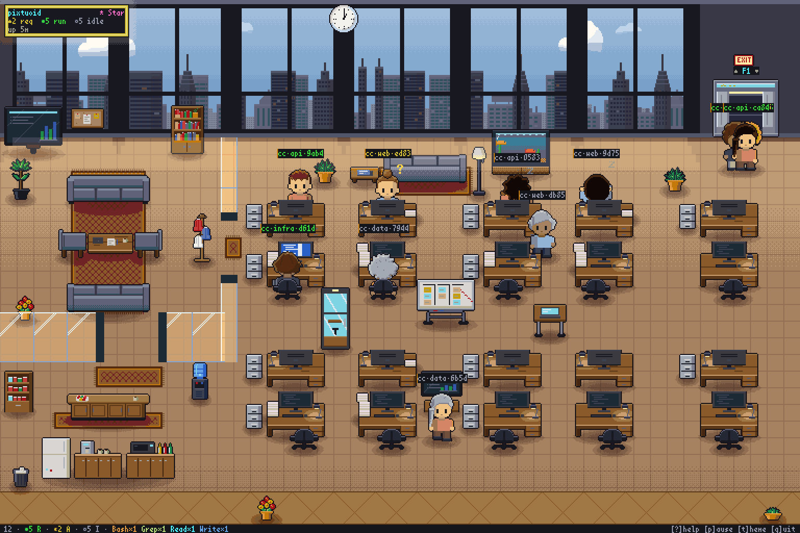
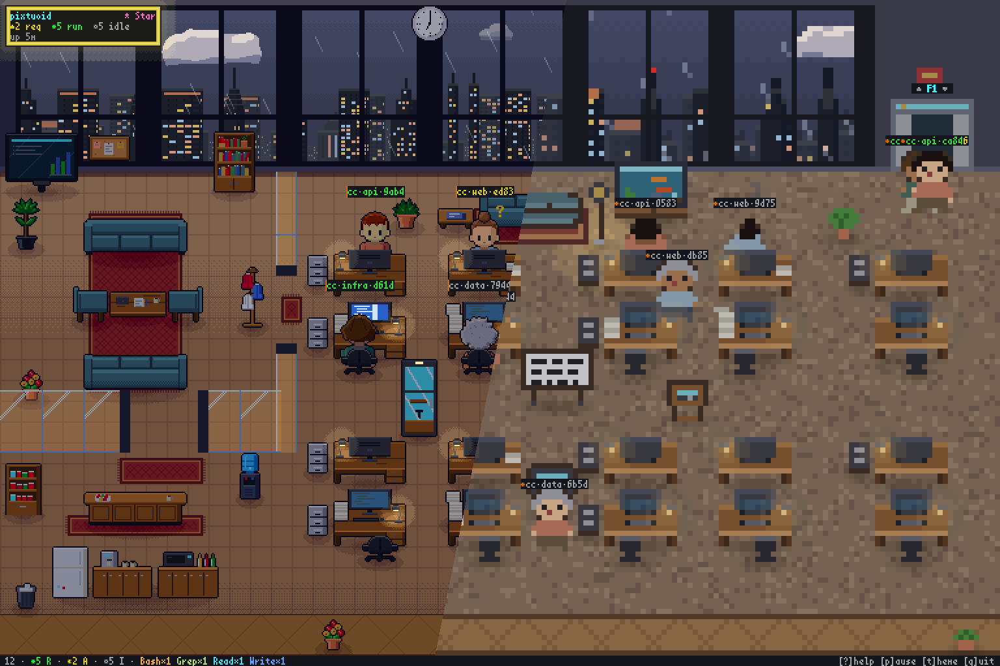
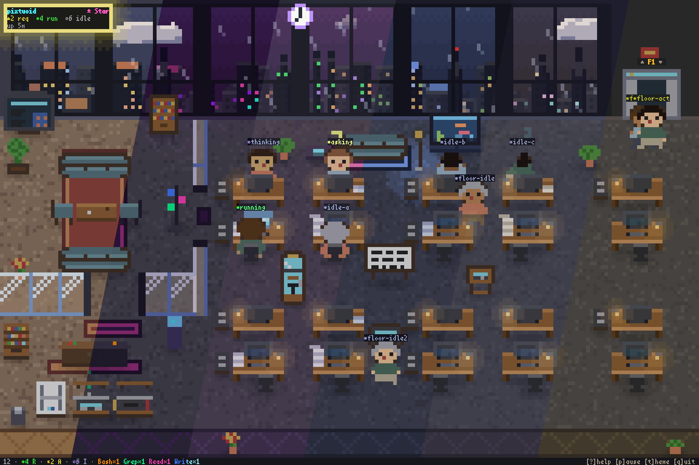

<p align="center">
  <picture>
    <source media="(prefers-color-scheme: dark)" srcset="docs/images/banner/banner-dark.svg" />
    
  </picture>
</p>

<p align="center">
  <samp>Your AI coding agents, visualized as pixel-art coworkers in a terminal office.</samp>
</p>

<p align="center">
  <sub><samp><b>pix</b>el + <b>tu</b>i + (agent-)<b>oid</b></samp></sub>
</p>

<p align="center">
  <a href="https://github.com/pixtuoid/pixtuoid/releases"></a>
  <a href="https://pixtuoid.dev/#tools"></a>
  <a href="https://github.com/pixtuoid/pixtuoid/actions/workflows/ci.yml"></a>
  <a href="https://github.com/pixtuoid/pixtuoid/actions/workflows/github-code-scanning/codeql"></a>
  <a href="https://codecov.io/github/pixtuoid/pixtuoid"></a>
  <a href="https://scorecard.dev/viewer/?uri=github.com/pixtuoid/pixtuoid"></a>
  <a href="LICENSE"></a>
</p>

<!-- media:demo:start · generated from scripts/media.json by `just gen-readme` — edit the JSON, not this block -->
<p align="center"><a href="https://pixtuoid.dev/"></a><br /><sub>Agents walk in, get to work and doze off as the day turns into a snowy night.</sub></p>
<!-- media:demo:end -->

<p align="center">
  <a href="https://pixtuoid.dev/">&nbsp;<strong>Live demo ↗</strong></a>
  &nbsp;·&nbsp; <a href="https://pixtuoid.dev/architecture">Architecture</a>
  &nbsp;·&nbsp; <a href="https://pixtuoid.dev/config">Configuration</a>
  &nbsp;·&nbsp; <a href="https://pixtuoid.dev/contributing">Contributing</a>
</p>

<p align="center">
  <a href="https://buymeacoffee.com/IvanWng97">
    <picture>
      <source media="(prefers-color-scheme: dark)" srcset="https://raw.githubusercontent.com/pixtuoid/pixtuoid/bmc-button/bmc-button-dark.svg" />
      <source media="(prefers-color-scheme: light)" srcset="https://raw.githubusercontent.com/pixtuoid/pixtuoid/bmc-button/bmc-button-light.svg" />
      
    </picture>
  </a>
</p>

## Why?

Running several coding agents means alt-tabbing between terminals to find out who's stuck, who's waiting on a permission prompt, and who finished ten minutes ago. **pixtuoid** puts them all in one tiny pixel-art office you can watch from above — every session is a character at a desk: typing while it works, raising a `?` when it needs you, dozing off when it's done.

A little bit *Black Mirror*, a little bit *The Sims* — and the most glanceable multi-agent dashboard you'll ever use.

## Quick Start

Pick one:

<!-- install:start · generated from site/src/install.json by `just gen-readme` — edit the JSON, not this block -->
**Homebrew** (Linux, macOS, or WSL2):

```bash
brew install pixtuoid
```

**npm** (any OS):

```bash
npm install -g pixtuoid
```
<!-- install:end -->

Then:

1. Run `pixtuoid`.
2. Press <kbd>s</kbd> and connect your agent CLI — pixtuoid sets it up for you, and `pixtuoid doctor` checks it if something's off.
3. Start that agent in another terminal — a coworker walks in from the elevator within a second.

<kbd>Tab</kbd> agent dashboard · <kbd>t</kbd> themes · <kbd>m</kbd> sound · click a coworker to bring its terminal to the front · <kbd>?</kbd> every other key

**More ways to install** — Cargo, prebuilt binaries, and Debian packages (`.deb`) — are on the **[install guide ↗](https://pixtuoid.dev/#install)**.

## Features

<!-- features:start · generated from site/src/features.json by `just gen-readme` — edit the JSON, not this table -->
| &nbsp;&nbsp;&nbsp;&nbsp;&nbsp;&nbsp;&nbsp; | Feature | Description |
|---|---|---|
|  | **Cutaway office** | Terminals that can show images (kitty, iTerm2, or SIXEL) can draw the cutaway, a detailed pixel view of the office; others get the classic look, drawn with text blocks |
|  | **Multi-agent office** | Every agent session gets its own desk — when a floor fills up, a new floor opens automatically |
|  | **Office spaces** | Cubicles, a meeting lounge, and a pantry — the office is laid out in distinct furnished zones, not just a grid of identical desks |
|  | **Animated characters** | Coworkers type, raise a `?` when they need you, nap under little z's, and walk between desks |
|  | **Team palette** | Agents in the same working directory wear the same colors, so you can see who works together at a glance |
|  | **Per-tool monitor glow** | Each desk's monitor glows with the tool in use — Edit blue, Bash orange, Read cyan — so you can read the whole room at a glance |
|  | **Token meter** | Paper piles up on a desk as its session uses tokens, growing at 250K, 2M and 16M; hover for the exact count |
|  | **Agent tree dashboard** | Press Tab to see every agent: which CLI it runs and what it's doing |
|  | **Office pets** | A cat or dog (one per floor) roams desks, pantry, sofas; sleeps near idle agents. Click to pet — pixel-art hearts float up |
|  | **Office vibes** | Day turns to night outside the windows, the weather changes, and each theme gives the office a new look |
|  | **Lofi soundtrack** | A lofi soundtrack, made entirely in code, follows the office's time, weather and activity; `m` mutes, `+`/`-` sets the volume |
|  | **Floating desktop window** | `pixtuoid floating` opens the office in a frameless, always-on-top window — on your desktop, not just in your terminal |
<!-- features:end -->

<!-- media:looks-composite:start · generated from scripts/media.json by `just gen-readme` — edit the JSON, not this block -->
<p align="center"><br /><sub>The same moment as the detailed cutaway (left) and the simpler classic look (right).</sub></p>
<!-- media:looks-composite:end -->

<p align="center">
  <a href="https://pixtuoid.dev/#showcase"><strong>▶ See every feature live — floors, themes, weather, pets, the office tour →</strong></a>
</p>

## Supported Tools

<!-- tools:start · generated from site/src/sources.json by `just gen-readme` — edit the JSON, not this table -->
<table>
<tr><td width="50%"><a href="https://code.claude.com">Claude Code</a></td><td width="50%"><a href="https://github.com/openai/codex">Codex CLI</a></td></tr>
<tr><td width="50%"><a href="https://github.com/google-antigravity/antigravity-cli">Antigravity CLI</a></td><td width="50%"><a href="https://github.com/esengine/DeepSeek-Reasonix">DeepSeek-Reasonix</a></td></tr>
<tr><td width="50%"><a href="https://github.com/codewhale-hq/Codewhale">CodeWhale</a></td><td width="50%"><a href="https://github.com/github/copilot-cli">Copilot CLI</a></td></tr>
<tr><td width="50%"><a href="https://github.com/anomalyco/opencode">opencode</a></td><td width="50%"><a href="https://cursor.com/cli">Cursor CLI</a></td></tr>
<tr><td width="50%"><a href="https://hermes-agent.nousresearch.com">Hermes Agent</a></td><td width="50%"><a href="https://omp.sh">Oh My Pi</a></td></tr>
<tr><td width="50%"><a href="https://github.com/openclaw/openclaw">OpenClaw</a></td><td width="50%"><a href="https://github.com/xai-org/grok-build">Grok Build</a></td></tr>
<tr><td width="50%"><a href="https://github.com/MoonshotAI/kimi-code">Kimi Code CLI</a></td><td width="50%"><a href="https://github.com/deepseek-ai/deepseek-harness">DeepSeek Harness</a></td></tr>
</table>

**→ [Every tool × OS on the site](https://pixtuoid.dev/#tools)**

_Windows support is experimental — limited testing, unsigned binaries._
<!-- tools:end -->

## Configuration

Press <kbd>t</kbd> to preview every theme live; your pick is saved.

<!-- media:themes-composite:start · generated from scripts/media.json by `just gen-readme` — edit the JSON, not this block -->
<p align="center"><br /><sub>Every built-in theme, one slice each.</sub></p>
<!-- media:themes-composite:end -->

Every other setting — desks per floor, pet names, cutaway or classic — lives in `~/.config/pixtuoid/config.toml` by default: see **[docs/CONFIGURATION.md](docs/CONFIGURATION.md)**.

## How It Works

pixtuoid learns what each agent is doing from a tiny hook it installs, which never holds up your agent, and from the agent's own session logs. It turns that into office life and draws it in your terminal.

**[Full architecture with diagrams →](https://pixtuoid.dev/architecture)**

## Privacy & Security

pixtuoid is **local-only and telemetry-free**: it makes no network connections, and your
agents' sessions never leave your machine. Details: **[SECURITY.md](SECURITY.md)**.

## Contributing

PRs welcome — especially new themes, art polish, and support for more agent CLIs. **[CONTRIBUTING.md](docs/CONTRIBUTING.md)** shows how to build, test and [add an agent CLI](docs/CONTRIBUTING.md#adding-a-new-agent-cli).

<p align="center">
  <picture>
    <source media="(prefers-color-scheme: dark)" srcset="https://raw.githubusercontent.com/pixtuoid/pixtuoid/star-history/star-history-dark.svg" />
    <source media="(prefers-color-scheme: light)" srcset="https://raw.githubusercontent.com/pixtuoid/pixtuoid/star-history/star-history-light.svg" />
    
  </picture>
</p>

<p align="center">
  <sub>Inspired by <a href="https://github.com/pablodelucca/pixel-agents"><code>pixel-agents</code></a> (VS Code), <a href="https://github.com/rullerzhou-afk/clawd-on-desk"><code>clawd-on-desk</code></a> (desktop pet) and Claude Code's <a href="https://dev.to/picklepixel/how-i-reverse-engineered-claude-codes-hidden-pet-system-8l7">Buddy</a> · <a href="LICENSE">MIT</a> licensed</sub>
</p>
