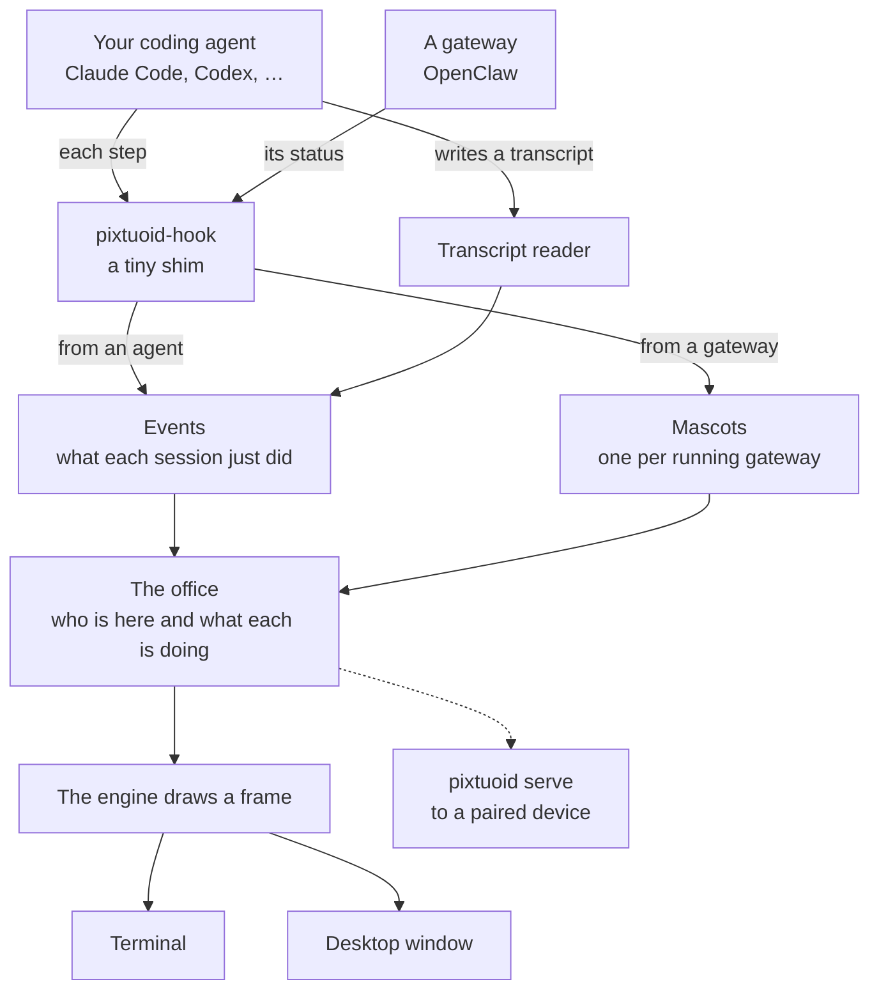

# How it works

How a running coding-agent session becomes a moving sprite in the office.

> This file is the **single source** for pixtuoid's architecture overview. It
> renders on the website at [`/how-it-works`](https://pixtuoid.dev/how-it-works/),
> where the stops below run a recorded Claude Code session through pixtuoid's
> own decoder, reducer and engine, built to WebAssembly. Contributor-level
> detail lives in `AGENTS.md` and the code's own doc comments.

## One event, five stops

When Claude Code reads a file, this is the path from its hook to the sprite at
its desk.

<!-- figure: journey -->

| Stop | In the code | What happens | Why |
| --- | --- | --- | --- |
| The agent | Claude Code's hooks | At each step of its work, Claude Code runs the hook command pixtuoid installed and writes one JSON object to its stdin. | A hook fires as the agent acts, so the sprite moves with it. pixtuoid also reads the transcript the agent writes, for what no hook reports, such as token use. |
| The shim | `pixtuoid-hook` | A small program stamps the line with the agent's name, its process id and the time, writes it to pixtuoid's local socket (a named pipe on Windows), and exits 0. | The agent waits for its hook. The shim gives up on a closed or slow pixtuoid within a fixed bound and still exits 0, so the office never holds your agent up. |
| The decoder | `decode_hook_payload` | The stamped name picks the decoder for that agent, which turns the line into events every agent shares. | Each agent words its hooks its own way. What one agent's format means lives in its decoder, so nothing past this stop asks which agent it is. |
| The office | `Reducer::apply` | The reducer folds the events into one picture of the office: who is here, at which desk, doing what. | Hooks and transcripts feed one channel into one reducer, so a step both report counts once, and every painter reads the same picture. |
| The frame | `look::render` | The engine draws that picture. The same call paints the terminal, the desktop window and the website. | The engine knows no terminal or window. Each painter only copies its pixels out, so the office looks the same wherever it runs. |

## Every way in

- **The transcript.** `JsonlWatcher` tails each agent's transcript and decodes
  its lines with that agent's own decoder. A first-sight gate keeps a session
  that ended before pixtuoid started from walking back in. Every source tags
  its events with how they arrived (`Transport`), and a hook wins over its
  transcript echo.
- **A second instance.** Its `HookRouter` subscribes to the socket's owner for
  the same lines, so each instance keeps its own reducer and viewport, and it
  takes the socket when that owner exits.
- **Time.** `Reducer::tick` sweeps stale slots on the driver's
  `SWEEP_TICK_INTERVAL_SECS` tick, and `SceneSink::publish` sends each changed
  scene as a fresh `Arc<SceneState>` on a `watch` channel, which the renderer
  borrows without a lock.
- **A gateway.** A daemon creates no agent slot and writes no transcript: the
  `HookRouter` decodes its payloads with the source's own `presence_decoder`
  and pushes `PresenceMsg { key: DaemonInstanceKey, delta }` onto a sibling
  channel, never the agent channel, which `apply_presence` merges into
  `SceneState::daemons`. A daemon has no per-session pid, so silence (a
  decayed TTL) is how it goes down abruptly.
- **Off the machine.** `pixtuoid serve` is this pipeline with no painter, the
  one listener on a network: paired devices on the LAN read the scene over
  pinned TLS as `pixtuoid_core::remote` lines, and may list the agent CLIs here
  and connect or disconnect them. A line carries no desk: a device seats
  everyone itself and renders with the same engine.

## The crates

pixtuoid is a Cargo workspace of six crates, and its dependency direction is
one-way: `pixtuoid-core ← pixtuoid-scene ← {pixtuoid, pixtuoid-web,
pixtuoid-web-music}`, with `pixtuoid-hook` standalone.

- **`pixtuoid-core`**: sources and decoders, the reducer and its scene state.
  No terminal dependencies.
- **`pixtuoid-scene`**: the engine, the office world itself (`look::render`,
  the sprite format, layout, pose, walking and pathfinding, themes, pets).
  Terminal- and window-free by crate boundary, so the compiler enforces it.
- **`pixtuoid`**: the binary: the CLI, the runtime wiring, and two thin
  painters over the engine: the terminal, as terminal images where the
  terminal draws them, else half-block (`▀`) cells, and the floating desktop
  window.
- **`pixtuoid-web`**: the painter behind the website's live office and the
  stops above, a wasm crate never published, with core's async runtime
  (`native`) off so core compiles to wasm32.
- **`pixtuoid-web-music`**: the website's ♩ lofi, in a wasm of its own that
  only the site's music worker loads.
- **`pixtuoid-hook`**: the shim, which always exits 0.

A **`Source`** is an **Agent**, a transcript- or hook-bearing coding CLI whose
events become a desk sprite, or a **Daemon**, a long-running gateway with no
transcript and no desk, shown as one wandering mascot per running instance.

## Beyond this workspace

- **[pixtuoid/lofi](https://github.com/pixtuoid/lofi)**: the procedural music,
  the `pixtuoid-lofi` crate that `pixtuoid-scene` plays.
- **The pixtuoid App** (iPhone and iPad, coming soon): a painter outside this
  workspace. It pairs with a `pixtuoid serve` from the link `pixtuoid pair`
  prints, connects over TLS pinned to that link's key on the local network,
  finds the computer again by DNS-SD when its address changes, and draws
  `pixtuoid_core::remote` lines with `pixtuoid-scene`, both built in from one
  pinned revision of this repository.
- **[pixtuoid/.github](https://github.com/pixtuoid/.github)**: what every
  repository shares. [How we build](HOW-WE-BUILD.md) lists the repositories
  and how the work runs across them.

## Seams & invariants

Load-bearing — see `AGENTS.md` and the nested crate guides before changing:

- The **`Source` trait** is the only seam for a transcript-bearing agent CLI;
  per-source format knowledge lives in that source's own decoders. Hook-only
  CLIs are the documented exception: registry rows with `transcript: None`, a
  custom hook decoder, and an install target.
- **Cross-source facts live in ONE registry row** (its module's `DESCRIPTOR`):
  prefix, decoders, hook decoding, capability flags. The reducer derives
  lifecycle policy from the flags — it never matches CLI names.
- **Events flow through one tagged channel**; producers tag their own events.
- **Subagent supervision is a scope tree**: exit cascades down, liveness
  flows up, permission-blocked subagents are exempt from the stale sweep.
- **The walkable mask is the ground footprint only** — sprites may be
  visually larger than the tile their base occupies.

## Where to go next

- **Configure it:** [`docs/CONFIGURATION.md`](CONFIGURATION.md) ·
  [live `/config`](https://pixtuoid.dev/config/)
- **Contribute:** [`CONTRIBUTING.md`](CONTRIBUTING.md)
- **Agent/contributor detail:** the workspace `AGENTS.md` + the nested
  per-crate `AGENTS.md` files.
