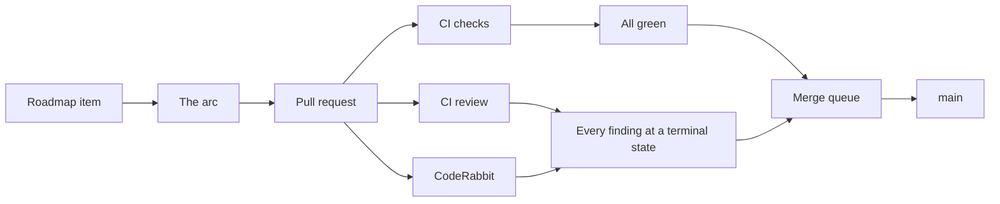

# How we build

pixtuoid is written, reviewed and maintained by AI coding agents working for
one owner, across a handful of repositories. This page maps who does what;
each part links the file that holds it, which wins wherever the two disagree.

## The repositories

| Repository | What it holds |
| --- | --- |
| [pixtuoid](https://github.com/pixtuoid/pixtuoid) | The CLI, the office engine and the [pixtuoid.dev](https://pixtuoid.dev) site |
| pixtuoid/apple (private) | The App for iPhone and iPad |
| [lofi](https://github.com/pixtuoid/lofi) | The procedural music the office plays |
| [.github](https://github.com/pixtuoid/.github) | What every repository shares, as its [AGENTS.md](https://github.com/pixtuoid/.github/blob/main/AGENTS.md) lists |
| [coderabbit](https://github.com/pixtuoid/coderabbit) | CodeRabbit's configuration for every repository |

## Who does what

Each role sees only what it needs, so a reviewer judges the change and not
the conversation that produced it.

| Role | Reads | Never sees | Acts by |
| --- | --- | --- | --- |
| The owner | The Roadmap, every PR, the agents' reports | Nothing is hidden from the owner | Deciding direction and taste, merging what no queue merges, cutting releases |
| A repository's session | Its repository, the org rules, the Roadmap | — | Designing, building test-first and opening each PR from [its branch's own worktree](CONTRIBUTING.md#parallel-sessions) |
| A subagent | The brief its session writes | The session's conversation | One scoped task, then a report |
| The CI review | The PR's title, body, diff and review threads, with the repository at the head as context and `AGENTS.md` and `REVIEW.md` as its rules | The author's conversation; it runs no code | A `Blocking: <n>` verdict and one thread per finding |
| CodeRabbit | The PR, with the repository's files as context and `REVIEW.md` as its guidelines | The author's conversation | Review threads |
| Mergify | The PR's checks and threads | The code | Merging once the queue's conditions hold |

## A change, end to end

The [arc loop](CONTRIBUTING.md#the-arc-loop) is the process, from picking a
[Roadmap](https://github.com/orgs/pixtuoid/projects/1) item to the wrap, and
[the merge gate](CONTRIBUTING.md#the-merge-gate) is how its PR lands, each
finding at a terminal state [dispositions](CONTRIBUTING.md#dispositions) defines.

## What keeps it honest

- **One set of rules.** The
  [org rules](https://github.com/pixtuoid/.github/blob/main/.github/actions/org-rules/org-rules.md)
  are copied into every agent guide (`AGENTS.md`), and CI fails when a copy
  drifts. Each of those repositories adds a `REVIEW.md` for what a review checks.
- **Evidence, not recall.** Every external claim follows the org rules'
  [Evidence bullet](../AGENTS.md#org-rules).
- **Real CLIs, not mocks of them**, as the [hermetic tier](CONTRIBUTING.md#build--test) runs them.
- **A lesson becomes a mechanism**, as the arc's [Wrap](CONTRIBUTING.md#the-arc-loop) step says.
