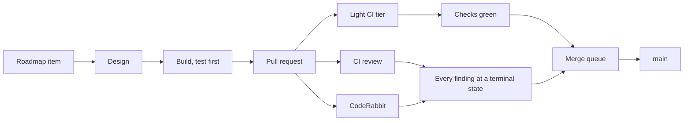

# How we build

pixtuoid is written, reviewed and maintained by AI coding agents working for
one owner, across a handful of repositories. This page is the process as it
runs today; each step links the file that holds it, which wins wherever the
two disagree.

## The repositories

| Repository | What it holds |
| --- | --- |
| [pixtuoid](https://github.com/pixtuoid/pixtuoid) | The CLI, the office engine and the [pixtuoid.dev](https://pixtuoid.dev) site |
| pixtuoid/apple (private) | The App for iPhone and iPad |
| [lofi](https://github.com/pixtuoid/lofi) | The procedural music the office plays |
| [.github](https://github.com/pixtuoid/.github) | What every repository shares: the CI review, the merge queue, the org rules and the agents' skills |
| [coderabbit](https://github.com/pixtuoid/coderabbit) | CodeRabbit's configuration for every repository |

## Who does what

Each role sees only what it needs, so a reviewer judges the change and not
the conversation that produced it.

| Role | Reads | Never sees | Acts by |
| --- | --- | --- | --- |
| The owner | The Roadmap, every PR, the agents' reports | Nothing is hidden from the owner | Deciding direction and taste, merging what no queue merges, cutting releases |
| A repository's session | Its repository, the org rules, the Roadmap | Another session's working tree | Designing, building test-first and opening PRs from its own [worktree](CONTRIBUTING.md#parallel-sessions) |
| A subagent | The brief its session writes | The session's conversation | One scoped task, then a report |
| The CI review | The PR's title, body, diff and review threads, `AGENTS.md`, `REVIEW.md` | The author's conversation; it runs no code | A `Blocking: <n>` verdict and one thread per finding |
| CodeRabbit | The PR, with the repository's files as context and `REVIEW.md` as its guidelines | The author's conversation | Review threads |
| Mergify | The PR's checks and threads | The code | Merging once the queue's conditions hold |

## A change, end to end

1. **Pick** a [Roadmap](https://github.com/orgs/pixtuoid/projects/1) item, an
   issue or a draft, kept current as the org rules' [Roadmap bullet](../AGENTS.md#org-rules) says.
2. **Design** before code, as the arc's [Grill the design and Design gate](CONTRIBUTING.md#the-arc-loop) say.
3. **Build** test-first, as the arc's [Build](CONTRIBUTING.md#the-arc-loop) says.
4. **Review locally** when the arc's [Local review](CONTRIBUTING.md#the-arc-loop) calls for it.
5. **Open a PR** whose body is what the org rules' [Comments bullet](../AGENTS.md#org-rules)
   asks of one, with the [must-run](../REVIEW.md#must-run) results.
6. **CI checks it**: the light tier ([Build & test](../AGENTS.md#build--test)), the
   [CI review](https://github.com/pixtuoid/.github/blob/main/.github/workflows/claude-review.yml),
   CodeRabbit and GitGuardian.
7. **Every finding reaches a terminal state** in its own thread, one of the
   states [dispositions](CONTRIBUTING.md#dispositions) defines.
8. **Queue it** as [the merge gate](CONTRIBUTING.md#the-merge-gate) says; the
   [queue](https://github.com/pixtuoid/.github/blob/main/.mergify.yml) merges it once its conditions hold.

## What keeps it honest

- **One set of rules.** The
  [org rules](https://github.com/pixtuoid/.github/blob/main/.github/actions/org-rules/org-rules.md)
  are copied into every agent guide (`AGENTS.md`), and CI fails when a copy
  drifts. Each of those repositories adds a `REVIEW.md` for what a review checks.
- **Evidence, not recall.** Every external claim follows the org rules'
  [Evidence bullet](../AGENTS.md#org-rules).
- **Real CLIs, not mocks of them.** The [hermetic tier](CONTRIBUTING.md#build--test)
  runs each profiled agent CLI for real against a scripted model, nightly at
  their latest releases.
- **A lesson becomes a mechanism**, as the arc's [Wrap](CONTRIBUTING.md#the-arc-loop) step says.
