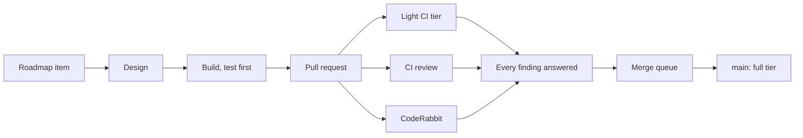

# How we build

pixtuoid is written, reviewed and maintained by AI coding agents working for
one owner, across a handful of repositories. This page is the process as it
runs today; each step links the file that holds it, which wins wherever the
two disagree.

## The repositories

| Repository | What it holds |
| --- | --- |
| [pixtuoid](https://github.com/pixtuoid/pixtuoid) | The CLI, the office engine and this site |
| pixtuoid/apple (private) | The App for iPhone and iPad, coming soon |
| [lofi](https://github.com/pixtuoid/lofi) | The procedural music the office plays |
| [.github](https://github.com/pixtuoid/.github) | What every repository shares: the CI review, the merge queue, the org rules and the agents' skills |
| [coderabbit](https://github.com/pixtuoid/coderabbit) | CodeRabbit's configuration for every repository |

## Who does what

Each role sees only what it needs, so a reviewer judges the change and not
the conversation that produced it.

<!-- figure: cards -->

| Role | Reads | Never sees | Acts by |
| --- | --- | --- | --- |
| The owner | The Roadmap, every PR, the agents' reports | Nothing is hidden from the owner | Deciding direction and taste, merging what no queue merges, cutting releases |
| A repository's session | Its repository, the org rules, the Roadmap | Another session's working tree | Designing, building test-first and opening PRs from its own worktree |
| The lead session | Every repository | Another session's working tree | The org-wide work and keeping the sessions aligned |
| A subagent | The brief its session writes | The session's conversation | One scoped task in its own worktree, then a report |
| The CI review | The PR's diff, `AGENTS.md`, `REVIEW.md` | The author's conversation; it runs no code | A `Blocking: <n>` verdict and one thread per finding |
| CodeRabbit | The PR's diff and `REVIEW.md` | The author's conversation | Review threads |
| Mergify | The PR's checks and threads | The code | Merging once the queue's conditions hold |

## A change, end to end

<!-- figure: flow -->

1. **Pick** a [Roadmap](https://github.com/orgs/pixtuoid/projects/1) item, an
   issue or a draft. The Roadmap is the plan of record, and every step
   updates its item.
2. **Design** before code: the open questions decided one at a time, the
   idiomatic way confirmed against fetched docs, the design red-teamed. A
   design another session builds on is agreed with that session first.
3. **Build** test-first: a failing test, then the smallest change that passes it.
4. **Review locally** when [CONTRIBUTING's step 7](CONTRIBUTING.md#the-arc-loop)
   calls for it, before the first push.
5. **Open a PR** whose body states its claims, each checked against the diff,
   and the results of the [must-run](../REVIEW.md#must-run) checks.
6. **CI checks it.** The light tier runs on every push; the
   [CI review](https://github.com/pixtuoid/.github/blob/main/.github/workflows/claude-review.yml)
   runs a correctness and a design reviewer over the diff; CodeRabbit and
   GitGuardian run beside them.
7. **Every finding reaches a disposition** in its own thread: fixed, or
   refuted with its evidence ([dispositions](CONTRIBUTING.md#dispositions)).
8. **Queue it.** The session comments `@mergifyio queue`; the
   [queue](https://github.com/pixtuoid/.github/blob/main/.mergify.yml) merges
   it once its conditions hold, and the full tier runs on `main`.

## What keeps it honest

- **One set of rules.** The
  [org rules](https://github.com/pixtuoid/.github/blob/main/.github/actions/org-rules/org-rules.md)
  are copied into each repository's `AGENTS.md`, and CI fails when a copy
  drifts. Each repository adds its own `REVIEW.md` for what a review checks.
- **Evidence, not recall.** A claim about another tool, a platform or a best
  practice cites a source fetched in that session, or is labelled opinion.
- **Real CLIs, not mocks of them.** The [hermetic tier](../crates/pixtuoid-core/tests/sources/README.md)
  runs each supported agent CLI for real against a scripted model, and every
  night it runs their latest releases and files an issue when one drifts.
- **A lesson becomes a mechanism.** A mistake that recurs ends as a test, a
  check or a rule line, never as an agent's private memory.
