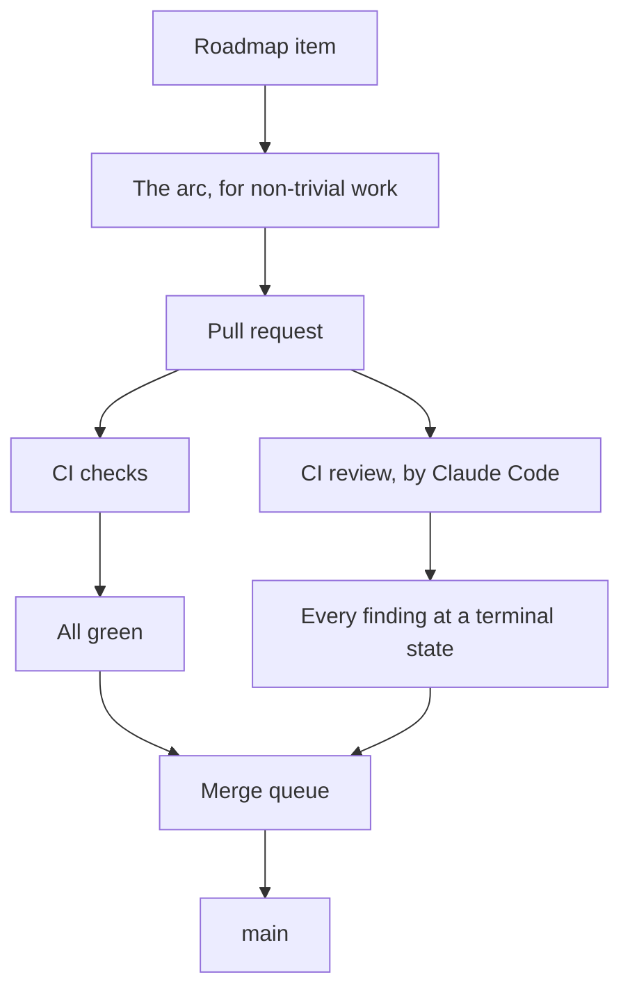

# How we build

pixtuoid is written, reviewed and maintained by AI coding agents working for
one owner, across a handful of repositories. This page maps who does what;
each part links the file that holds it, which wins wherever the two disagree.

## The repositories

| Repository | What it holds |
| --- | --- |
| [pixtuoid](https://github.com/pixtuoid/pixtuoid) | The CLI, the office engine and the [pixtuoid.dev](https://pixtuoid.dev) site |
| pixtuoid/apple (private) | The App for iPhone and iPad |
| [lofi](https://github.com/pixtuoid/lofi) | The procedural music the office plays |
| [.github](https://github.com/pixtuoid/.github) | What every repository shares, as its [AGENTS.md](https://github.com/pixtuoid/.github/blob/main/AGENTS.md) lists |

## Who does what

<!-- figure: cards -->

| Role | Acts by |
| --- | --- |
| The owner ([AGENTS.md](../AGENTS.md)) | Setting the bar and the Roadmap, reviewing every doc change, merging the release PR by hand |
| A session ([Parallel sessions](CONTRIBUTING.md#parallel-sessions)) | Working one branch in its own worktree, through the arc when the work is non-trivial and always through the merge gate |
| A subagent ([local review](https://github.com/pixtuoid/.github/blob/main/plugins/pixtuoid-dev/skills/local-review/SKILL.md)) | Reviewing or verifying one scope for its session, then reporting |
| [The CI review](https://github.com/pixtuoid/.github/blob/main/.github/workflows/claude-review.yml), an AI code review Claude Code runs | Posting a verdict and its findings on the PR |
| [Mergify](https://github.com/pixtuoid/.github/blob/main/.mergify.yml) | Merging once the queue's conditions hold |

## A change, end to end

Non-trivial work runs as the [arc loop](CONTRIBUTING.md#the-arc-loop), from picking a
[Roadmap](https://github.com/orgs/pixtuoid/projects/1) item to the wrap; any PR, an
arc's or not, lands through [the merge gate](CONTRIBUTING.md#the-merge-gate), each
finding at a terminal state [dispositions](CONTRIBUTING.md#dispositions) defines.

<!-- figure: flow -->

## What keeps it honest

- **One set of rules.** The
  [org rules](https://github.com/pixtuoid/.github/blob/main/.github/actions/org-rules/org-rules.md)
  are copied into each repository's root agent guide (`AGENTS.md`), and CI fails
  when that copy drifts. Each of those repositories adds a `REVIEW.md` for what a review checks.
- **Evidence, not recall.** Every external claim follows the org rules'
  [Evidence bullet](../AGENTS.md#org-rules).
- **Real CLIs, not mocks of them**, as the [hermetic tier](CONTRIBUTING.md#build--test) runs them.
- **A lesson becomes a mechanism**, as the arc's [Wrap](CONTRIBUTING.md#the-arc-loop) step says.
