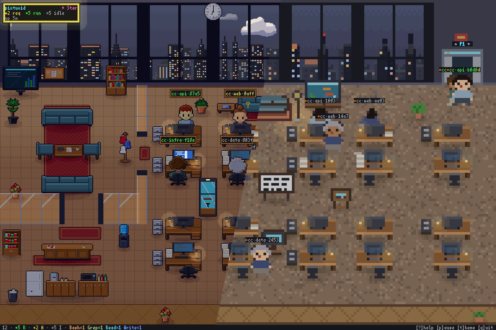

pixtuoid draws your AI coding agents as coworkers in a pixel office, inside
your terminal. It has two looks. This is the same moment in both:



On the right is the classic look, made of half-block characters, two pixels
to a terminal cell. On the left is the cutaway: real pixels, sent through the
kitty, SIXEL or iTerm2 image protocol.

Pixels are prettier. They are also a great deal more work, and the office
redraws thirty times a second. **A frame gets 33 ms.**

On September 30 we measured the cutaway for the first time. Painting one
night frame took 43.4 ms. Not sending it. Just painting it.

Ten days later the whole pipeline around that frame had been rebuilt, and on
October 21 the cutaway became the default look
([#1835](https://github.com/pixtuoid/pixtuoid/pull/1835)). This is what we
changed, in the order we changed it, with how each change works, what it cost
and what we threw away.

Every number here is quoted from the pull request it links to. They come from
different days, machines and terminals. **Compare each pair with itself, and
never add them up.** The code is quoted from the repository as it stands
today, so a few details are later than the pull request that introduced them.

## Where a frame's 33 ms go


Compose decides what to draw. Paint fills in the pixels. The frame is cut
into tiles, each changed tile is encoded for the terminal's image protocol,
and the bytes are sent to the terminal, which shows them.

Every section below takes one of these stages and makes it do less.

## Painting a night frame: 43.4 ms → 10.5 ms

**That's 4.1x faster**, from one pull request, merged the same day as the
measurement ([#1134](https://github.com/pixtuoid/pixtuoid/pull/1134)).

Here is what that does to a loop that owes a frame every 33 ms. Each tick is
a frame coming due, and each block is one being painted.

<!-- figure: budget -->

| Frame               | Takes   | Budget |
| ------------------- | ------- | ------ |
| Night frame, before | 43.4 ms | 33 ms  |
| Night frame, after  | 10.5 ms | 33 ms  |

Before, the first frame runs past its tick, and every frame after it starts
later than the one before. After, a frame is painted with most of its budget
left for everything else.

It began with a pull request that changed nothing
([#1100](https://github.com/pixtuoid/pixtuoid/pull/1100)). It only added a
bench: paint a busy office at noon, paint it at night, time both. Night was
the slow one. At night every lamp and screen lights the pixels around it.

A profile of that frame said where the time went: about a third in a
per-pixel colour cache and its colour maths, about a quarter in copies made
around every piece of furniture, about a quarter in building the list of
things to draw. #1134 took them one at a time.

**Resolve the lights once, not per pixel.** Before the lighting pass walks
the buffer, it builds one dense map: for each pixel of the room, which light
is brightest there. Lights are written in rank order and only overwrite a
dimmer one, so ties resolve the same way every frame.

**Cache the colour, keyed by everything it depends on.** The lit colour of a
pixel is a pure function of six inputs. The cache key is all six, so a hit
can never be stale:

```rust
// crates/pixtuoid-scene/src/cutaway/light.rs
pub(crate) struct NetMemo {
    colours: std::collections::HashMap<NetKey, Rgb, foldhash::fast::FixedState>,
    /// Neighbouring pixels mostly ask the last question again.
    last: Option<(NetKey, Rgb)>,
}

/// Everything [`net_colour`] reads for one pixel.
type NetKey = (Rgb, Glow, u8, Option<Rgb>, Ambient, Flash);
```

Two details carry most of the win. The cache survives from frame to frame. And
in front of it sits a one-entry shortcut, because the pixel next door almost
always asks the same question.

The first version packed that key into a `u64` by hand. Review found two different inputs that packed to the same number. The key became the tuple, and the numbers here are the tuple's.

**Stop diffing copies to see what a piece drew.** To know which pixels a
desk lamp had lit, the painter copied the region before and after and
compared. Now the buffer keeps, per pixel, the number of the last write to
touch it:

```rust
// crates/pixtuoid-scene/src/sprite/mod.rs
pub(crate) fn begin_writes(&mut self) -> WriteEpoch {
    let n = self.pixels.as_slice().len();
    let w = self.writes.get_or_insert_with(|| Writes {
        at: vec![0; n],
        now: 0,
        tracking: false,
    });
    w.tracking = true;
    w.now = w.now.wrapping_add(1);
    if w.now == 0 {
        w.at.fill(0);
        w.now = 1;
    }
    WriteEpoch(w.now)
}
```

Start an epoch before a piece paints, and afterwards "which pixels did it
write" is one comparison a pixel. It also fixed a bug a diff cannot see: a
piece that paints a pixel in the colour already there.

Noon came along for free: 13.0 ms → 8.2 ms. The cost was memory. The cutaway
benches went from 3 MB to 4 MB.

_`render_cutaway` bench, 240×144 at scale 4, both runs back to back on one
machine._

## Encoding a frame: 34 ms → 9.5 ms

Painting is half the job. The painted frame still has to become bytes a
terminal accepts, and that ran on one core.

[#1282](https://github.com/pixtuoid/pixtuoid/pull/1282) cut the frame into
tiles and encoded them on every core. **3.6x faster**, same bytes on the
wire.

The whole scheduler is thirty lines, and it has no dependencies:

```rust
// crates/pixtuoid-scene/src/par.rs
let next = AtomicUsize::new(0);
let work = || {
    let mut done = Vec::new();
    loop {
        let i = next.fetch_add(1, Ordering::Relaxed);
        let Some(item) = items.get(i) else {
            return done;
        };
        done.push((i, f(item)));
    }
};
let mut out: Vec<Option<U>> = std::iter::repeat_with(|| None).take(items.len()).collect();
std::thread::scope(|s| {
    let helpers: Vec<_> = (1..threads).map(|_| s.spawn(work)).collect();
    let mine = work();
    // ...join the helpers, then write every (i, result) into out[i]
});
```

Every thread, the calling one included, takes the next unclaimed tile from
one shared counter. A slow tile holds up nobody. Each result carries its
index, so the tiles come back in order whichever thread encoded them.

How many threads? One for every two tiles, and never more than the cores.
One changed tile is not worth waking a second core for.

_One whole frame of 1,275 tiles, kitty protocol, zlib._

### A thread pool lost, and the reason was a cold core

The obvious next step was a library pool that keeps its threads alive between
frames. We measured it, frame by frame, against starting fresh threads
([#1497](https://github.com/pixtuoid/pixtuoid/pull/1497)).

The pool's 99th-percentile frame took 34.7 ms and 48.7 ms over two runs.
Fresh threads took 21.9 ms and 27.7 ms. In the pool's worst frames only 4 to
6 of its 10 workers were running. The work sat waiting on the ones that had
gone to sleep. Reverted.

The same pull request found out why this was happening at all. Our benches
ran frames back to back. The real program paints a frame and then **sleeps**
until the next tick.

Run back to back, the 99th-percentile frame took 11.9 ms. Paced the way the
program really runs, it took 44.6 ms. Same code. A frame that wakes on a core
that has cooled down runs three to five times slower in every stage at once.

That changed what we measured for the rest of the work. A bench that never
sleeps was telling us about a program we do not ship.

It costs something, too. Spreading the encode across cores takes about a
quarter more CPU in total. On battery that is the price of the shorter wait.

## Repainting what changed, not 6.8 million pixels

Most frames barely differ from the last one. A cursor blinks. A fish swims.

The painter already knew which rectangles had changed. It used them to decide
what to **send**. Then it repainted the entire frame anyway.

<!-- figure: repaint -->

| Pass                       | Pixels             |
| -------------------------- | ------------------ |
| Before: the whole frame    | 6.8 million        |
| After: around what changed | 7,936 that changed |

On a typical frame, 7,936 pixels could change, and the painter repainted about 850 times that ([#1389](https://github.com/pixtuoid/pixtuoid/pull/1389)).

**Finding what changed.** Each thing in the frame, a desk, a lamp, a
coworker, carries the area it can touch and a 64-bit fingerprint of what it
would paint. Compare this frame's list with the last one's. Whatever appears
in only one of them marks a rectangle as dirty. Nothing is diffed pixel by
pixel.

A frame is then one of three things: all of it changed, some rectangles
changed, or nothing did.

**Repainting only there.** The repaint is the same paint, run under a clip.
There is no second code path for partial frames to drift away from the first:

```rust
// crates/pixtuoid-scene/src/sprite/mod.rs
pub(crate) fn with_clip<T>(
    &mut self,
    (columns, rows): (Range<u16>, Range<u16>),
    paint: impl FnOnce(&mut Self) -> T,
) -> T {
    let (xs, ys) = self.writable();
    let clip = (
        columns.start.max(xs.start)..columns.end.min(xs.end),
        rows.start.max(ys.start)..rows.end.min(ys.end),
    );
    let was = self.clip.replace(clip);
    let painted = paint(self);
    self.clip = was;
    painted
}
```

Every write goes through that clip, and a piece that misses it is skipped
before it draws anything. A test paints every frame both ways and compares
the pixels.

One box around the changes took a typical noon frame from 8.26 ms to 3.80 ms.

### Why eight boxes

One box has a flaw. At night, a frame changes the sky along the top of every
window and one lamp far below. The box around both covers 40 to 70% of the
frame.

One box for every change has the opposite flaw. Each pass walks the whole
list of things to draw, so two dozen tiny passes cost more than one big one.

So the changes are merged
([#1402](https://github.com/pixtuoid/pixtuoid/pull/1402)):

<!-- figure: boxes -->

| Step              | Count                |
| ----------------- | -------------------- |
| What changed      | two dozen rectangles |
| What is repainted | eight boxes at most  |

The rule is short. Put every pair of rectangles in a heap, ordered by how
much extra area their union would add. Overlapping pairs go first, whatever
the count, so no pixel is ever painted twice. Then keep merging the cheapest
pair until eight are left:

```rust
// crates/pixtuoid-scene/src/cutaway/canvas.rs
// Overlapping pairs first, then by the area a merge adds.
let key = |a: &Bounds, b: &Bounds| (!a.overlaps(*b), area(&a.union(*b)) - area(a) - area(b));
// ...
while let Some(Reverse(((apart, _), i, j))) = heap.pop() {
    let (Some(a), Some(b)) = (boxes[i], boxes[j]) else {
        continue;
    };
    if apart && alive <= max.max(1) {
        break;
    }
    let merged = a.union(b);
    // ...replace the two with their union, and push its pairs
}
```

Why eight? We measured it. These are the slowest 5% of repaints:

| Boxes | At night | While the weather changes |
| ----- | -------- | ------------------------- |
| 1     | 4.78 ms  | 7.85 ms                   |
| 2     | 3.64 ms  | 6.19 ms                   |
| 4     | 2.46 ms  | 5.24 ms                   |
| 8     | 1.70 ms  | 4.77 ms                   |
| 12    | 1.63 ms  | 5.17 ms                   |
| 64    | 3.53 ms  | 10.90 ms                  |

Twelve is barely better at night and worse when the weather turns. Sixty-four is worse than one when the weather turns. Eight it is, on the machine we measured.

A change to the whole frame gets nothing from any of this. Lightning still
repaints everything.

### Not recomputing what cannot have changed

The view through the windows and each lamp's pool of light are expensive, and
they rarely change between frames. A lamp's inputs repeat on 99% of frames. The window view's repeat on 73%
([#1395](https://github.com/pixtuoid/pixtuoid/pull/1395)).

So each is kept with the inputs it was computed from, and reused when the
inputs match:

```rust
// crates/pixtuoid-scene/src/outside.rs
#[derive(Debug, PartialEq)]
pub(crate) struct OutsideKey {
    sky: crate::sky::Sky,
    altitude: f32,
    beat: crate::anim::Beat,
    wall: Wall,
    density: Density,
    weather: GlassWeather,
}
```

The function that draws the windows takes that struct, plus the art and the theme. It cannot read anything else, so the key cannot be missing a field. The cache is emptied whenever the art or the theme changes.

Composing a noon frame went from 1.77 ms to 0.48 ms. It is not free: holding
the last frame's windows raised the peak memory of a 360×240 render from
562.6 KB to 639.5 KB. That's 77 KB more, and we took the trade.

## Sending fewer bytes

An idle office was streaming about 1.3 MB a second to the terminal. Every
tile went out as raw pixels.

**Do not send a tile that did not change.** Only the tiles the damage reaches
are looked at. Each is hashed, and sent only if its hash differs from the one
it was last sent with:

```rust
// crates/pixtuoid/src/graphics/tiles.rs
fn hash(&self, buf: &RgbBuffer, tile: Tile) -> u64 {
    let (iw, ih) = self.image_px();
    let xs = self.source(tile.col, tile.cols, self.cell.w, iw);
    let pixels = buf.as_slice();
    // A collision would hold a changed tile back: the display list's
    // fingerprints take the quality hasher for the same reason.
    let mut h = foldhash::quality::FixedState::with_seed(0).build_hasher();
    for y in self.source(tile.row, tile.rows, self.cell.h, ih) {
        let row = y * usize::from(buf.width());
        Hash::hash_slice(&pixels[row + xs.start..row + xs.end], &mut h);
    }
    h.finish()
}
```

It hashes the tile's **source** pixels, before they are scaled up for the
screen. At 16x that is 256 times fewer bytes to hash than the tile shows.

**Compress what you do send.** For kitty, one line of keys tells the terminal
how to read a tile:

```rust
// crates/pixtuoid/src/graphics/kitty.rs
format!(
    "a=T,U=1,i={id},f=24,{transport_keys}s={width},v={height},c={},r={},",
    tile.cols, tile.rows
)
```

`f=24` is raw RGB. Adding `o=z` says the payload is zlib-compressed. At the
fastest zlib level a typical tile shrank about 10x and took 13.5 µs to
compress ([#1197](https://github.com/pixtuoid/pixtuoid/pull/1197)). Every
tile keeps a stable image id, so sending it again replaces the old one in
place.

**SIXEL's and iTerm2's encoders** got faster ([#1400](https://github.com/pixtuoid/pixtuoid/pull/1400)): one pass over each band of pixels for SIXEL, and the fastest PNG compression for iTerm2. A whole frame
went from 35.8 ms to 17.9 ms on SIXEL, and from 24.3 ms to 11.1 ms on iTerm2.

The iTerm2 one is a trade made on purpose. iTerm2 takes PNG, and the fastest
PNG compression makes files more than twice the size. The extra bytes cost
about 1.4 ms to write. The slower compression cost 13 ms to run.

One idea did not survive. Tracking which columns each SIXEL colour spans
looked like a saving and measured as a loss: 67 µs → 106 µs
([#1417](https://github.com/pixtuoid/pixtuoid/pull/1417)).

## Fewer bytes did not help. Fewer images did.

Then came the change that taught us the most.

For a terminal on the same machine, a tile does not need to travel as text at
all. kitty's protocol lets a program write the pixels into shared memory and
send only the name
([#1423](https://github.com/pixtuoid/pixtuoid/pull/1423)).

We do not guess whether the terminal is local. We ask: publish one pixel,
send its name, and use shared memory only if the terminal says it could read
it. A terminal on another machine cannot open the name, and says so.

Bytes per frame fell from about 275 KB to about 15 KB. **18x fewer.**

The slow frames barely moved. The 99th-percentile frame, the one in a hundred
you actually notice, went from 157 ms to 140 ms.

The terminal was not slow because of the bytes. Measuring with the window at
three sizes showed what it was slow because of
([#1445](https://github.com/pixtuoid/pixtuoid/pull/1445)):

| Window       | Tiles on screen | 99th-percentile frame |
| ------------ | --------------- | --------------------- |
| 100×30 cells | about 375       | 11.3 ms               |
| 150×40 cells | about 760       | 40.4 ms               |
| Maximized    | about 1,368     | about 150 ms          |

The pull request traced it into Ghostty's source: for each image we re-send,
Ghostty walks every image already on screen. A frame costs the tiles we send
times the tiles that are there.

So a tile now grows until the whole frame fits a budget of 400 images:

<!-- figure: tiles -->

| Tiles                                    | Images      |
| ---------------------------------------- | ----------- |
| Before: small tiles, whatever the window | about 1,368 |
| After: tiles that grow with the window   | 400 at most |

```rust
// crates/pixtuoid/src/graphics/tiles.rs
fn fitted(&self) -> TileShape {
    let mut shape = self.protocol.tile();
    let Some(budget) = self.protocol.image_budget() else {
        return shape;
    };
    loop {
        let (across, down) = self.grid(shape);
        if across * down <= budget || (across == 1 && down == 1) {
            return shape;
        }
        shape = TileShape {
            cols: shape.cols.saturating_mul(2),
            rows: shape.rows.saturating_mul(2),
        };
    }
}
```

Double the tile in both directions until the count fits. A small window keeps
the smallest tiles and the finest diff. A big one trades a coarser diff for a
terminal that keeps up.

In a storm, the 99th-percentile frame went from 148.9 ms to 35.5 ms. At dusk,
from 74.8 ms to 6.1 ms.

_Maximized Ghostty, a 239×123 office at 16x, 60 seconds a run._

We kept the shared memory. It saves CPU on every frame. It just was not the
fix it looked like.

## The window: 235.9 ms/s late → 1.0 ms/s

`pixtuoid floating` shows the same office in a window of its own. It scaled
the office up on the CPU and copied the whole window to the screen for every
frame. On a 4K display that alone blew the budget.

[#1524](https://github.com/pixtuoid/pixtuoid/pull/1524) stopped painting a
window and started describing one: a list of layers, each with its pixels,
where it goes, a whole-number scale, and whether it changed.

The GPU keeps one texture for each layer. An unchanged layer uploads nothing.
The office uploads only its dirty rectangles. The GPU does the scaling, with
nearest-neighbour sampling so a whole-number scale stays pixel-exact, and the
blending. When no layer changed, nothing is presented at all.

The scene itself is still painted on the CPU, by everything above. The GPU
only scales it and puts the layers together.

In a storm, frames had been arriving 235.9 ms late for every second the
office ran. Now it is 1.0 ms. At dusk: 167.4 → 0.1. CPU use fell from about
60% to under 20%.

The price: the release binary grew from 7,948,640 to 11,266,240 bytes, and a
clean build went from 80 seconds to 105. Every install pays that, whether it
opens the window or not.

_M1 Max, external 4K display, 200 seconds a run, one run each._

## How we know it is smooth

A bench tells you how fast one frame can be. It does not tell you whether the
office looks smooth. A frame that is ready early still waits its turn. A frame
that is late shows late.

Our first gate asked for a 99th-percentile frame under 20 ms
([#1385](https://github.com/pixtuoid/pixtuoid/pull/1385)). That 20 ms was one
machine's number.

[#1497](https://github.com/pixtuoid/pixtuoid/pull/1497) replaced it with the
**hitch rate**, which Apple [measures](https://developer.apple.com/documentation/xcode/understanding-hitches-in-your-app) in "milliseconds of pause per second", and calls good "at or below 10 ms/s".

Every scheduled frame knows the instant it was due. When it has been shown,
four lines do the counting:

```rust
// crates/pixtuoid/src/jank.rs
if let Some(due) = self.due.take() {
    self.hitch += now.saturating_duration_since(due + PAINT_FRAME);
    self.scheduled += 1;
}
```

A frame shown anywhere inside its own 33 ms adds nothing. A late one adds
exactly how late it was, whether it rendered slowly or simply woke up late.
The rate is the total lateness divided by the seconds the office ran.

We got that count wrong three times first, and the pull request says so. One
version missed a late wake. One counted whole intervals. One compared each
frame with the one before, and turned ordinary variance into lateness: two
slow frames in a minute read as 8.3 seconds of hitching.

`just pace-check` runs the release binary into a storm and across dusk, on a
simulated clock, and fails above 10 ms/s. Four runs at the end of the work
read 0.32, 0.12, 0.18 and 0.53.

It runs on a quiet developer machine before a release, and never in CI. A
shared runner's clock is too noisy to judge a 33 ms budget, and under other
builds the same code read 90 to 321.

## Try it

The cutaway is on by default wherever pixtuoid can reach your terminal's image
protocol. Over ssh, inside GNU screen and under tmux's default settings you
get the classic look, and `pixtuoid doctor` says why.
